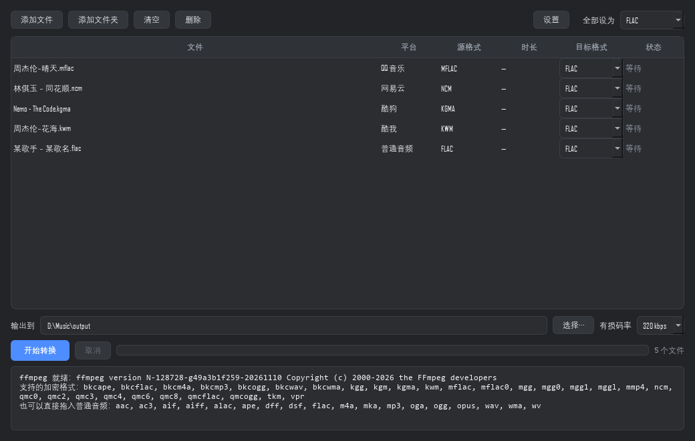

# 音乐解锁

把国内几个音乐平台下载的加密音频解成普通音频，并转成你想要的格式。
带图形界面，拖进去、选格式、点开始。界面支持**浅色 / 深色 / 跟随系统**三种主题。

**不只是解密工具**：普通音频（flac / mp3 / wav / m4a / ogg …）也可以直接拖进来，
当成一个纯格式转换器用。

> **仅供个人学习与自用。** 请支持正版音乐，不要拿它做商业分发。



## 它解决什么问题

会员下载的歌曲被包在平台的专属格式里，拷到别的播放器、车机、剪辑软件里放不了。
这个工具把加密层去掉，再按需转成通用格式——**解密和转码是两件独立的事**，
所以你可以只要解密（保持原格式），也可以顺手转成 MP3 拷到 U 盘。

支持 QQ 音乐、网易云、酷狗、酷我四个平台，都是 PC 客户端能下到的格式。

## 支持的输出格式

| 格式 | 编码 | 无损 | 起步体积（1 小时 / 44.1k / 16bit 双声道） | 适用场景 |
|---|---|---|---|---|
| WAV | PCM | ✅ | ≈ 635 MB | 剪辑素材、通用播放器 |
| FLAC | FLAC | ✅ | ≈ 350–400 MB | 归档首选，带封面和标签 |
| AIFF / AIF | PCM 大端 | ✅ | ≈ 635 MB | 老 Mac、Pro Tools |
| ALAC | ALAC (m4a) | ✅ | ≈ 380–430 MB | iPhone / iTunes |
| BWF | PCM + bext | ✅ | ≈ 635 MB | 广播、后期过审 |
| MP3 | libmp3lame | ❌ | V0 ≈ 100 MB / 320k ≈ 144 MB | 兼容性之王 |
| OGG Vorbis | libvorbis | ❌ | ≈ 115 MB | Android、开源播放器 |
| AAC | AAC (m4a) | ❌ | ≈ 115 MB | 手机、耳机、车载 |
| Opus | libopus | ❌ | ≈ 72 MB | 低码率最强，省空间 |
| AC3 | AC3 | ❌ | ≈ 288 MB | 家庭影院（上限 640k） |

几点必须知道：

* **源格式 = 目标格式时会直接封装，不重新编码**，不给音质二次伤害。
* **有损源转无损目标不会变好听**，只会让文件变大。工具会在状态栏提前提示，
  但不会拦着你——如果你是拿它当剪辑素材，那是对的用法。
* 位深默认跟随源：24bit 的母带转 WAV/AIFF/ALAC 时不会被悄悄降到 16bit。
* 24 → 16bit 会自动加三角抖动，避免量化失真。
* WAV / AIFF / BWF / OGG / Opus / AC3 不支持封面，转过去封面会丢
  （ffmpeg 的 ogg 封装器不接受附加图片，vorbis / opus 都塞不进去）；AC3 连标签都没有。
* Opus 内部固定 48kHz，任何源码率都会被重采样。

## 支持的加密格式

| 平台 | 格式 | 实现 | 真实文件验证 |
|---|---|---|---|
| QQ 音乐 | qmc0 / qmc3 / qmcflac / qmcogg | ✅ | ✅ |
| QQ 音乐 | mflac / mflac0 / mgg / mgg0 / mgg1 / mggl | ✅ | ✅ |
| QQ 音乐 | `musicex`（2026 新版客户端） | ✅ 首次需借客户端取密钥 | ✅ |
| QQ 音乐 | `STag` | ❌ 密钥不在文件里 | — |
| QQ 音乐 | `mmp4` | ⚠️ 只取音轨，视频丢弃 | ❌ |
| 网易云音乐 | ncm（含歌名/歌手/专辑/封面） | ✅ | ✅ 两个真机样本 |
| 酷狗音乐 | kgm / kgma / vpr | ✅ | ✅ 四个真机样本 |
| 酷狗音乐 | kgg（新版） | ❌ 密钥机制不同 | — |
| 酷我音乐 | kwm | ✅ | ✅ 三个真机样本 |

**两种验证要分清**：

* **实现的正确性**由自动化测试保证——每个平台都能用「造一个加密文件 → 解回来 →
  逐字节比对」的方式验证，加上 AES 这类有标准向量的部分（FIPS-197）。
* **真实文件能不能解**是另一回事。QQ 音乐（qmc / musicex）和酷狗（kgma，四个 90MB 级的
  真机样本）、网易云（两个真机样本）、酷我（三个真机样本）都已经端到端跑通了。

主动不做的：

* **酷狗 `kgg` 新版**——密钥机制和 kgm 完全不同，连公开实现都没有；
* **汽水音乐 `mdl`**——缓存分片，没有公开方案；
* **咪咕 `mg3d`**——咪咕没有 PC 客户端，这种格式只有手机缓存才会产生，
  而本工具面向的是 PC 用户，做出来也用不上。

一句话原则：**只做 PC 客户端能下到的格式。**

### STag 为什么不支持

尾部是 `STag` 的文件，密钥完全没有写进文件，只在客户端运行时才有。
理论上可以让客户端自己吐明文（构造对象 → Open → Read 循环），但实测下来
客户端的 `Read` 接口拿不到数据，这条路上没有成功过；而这类文件在新版客户端里
已经基本被 `musicex` 取代。所以直接明确不支持，而不是留一个会误导人的半成品。

遇到 STag 的处理办法：在 QQ 音乐里重新下载，新版客户端产出的 `musicex` 是支持的。

### musicex（2026 新版客户端）

2026 版客户端下载的文件尾部是 `musicex\0`，而不是 `STag` / `QTag`：

```
[加密的音频本体]
[192 字节元数据块]
[u32 192][u32 1]"musicex\0"
```

192 字节块里有：16 字节疑似密钥材料、几个 u32、UTF-16 的 14 字符 id
（如 `001yS0N33yPm1B`）、UTF-16 的原文件名。

**结论：这不是新的密码学方案。** 音频本体仍然是 QMCv2 的 RC4 流密码，
`derive_key(ekey)` + `QmcRC4Cipher` 就能解——只是 **ekey 不再写在文件里**，
客户端从服务端取。

所以流程是：

1. 首次处理时，程序用系统关联打开一次该文件（QQ 音乐会自己走一遍正常打开流程）；
2. 同时用 Frida 监听客户端的 `SetEkey`，把候选密钥抓下来；
3. **每个候选密钥都拿去试解文件头**，能解出 `fLaC` / `OggS` 的才算数
   （这样即使客户端同时在放别的歌也不会认错）；
4. 密钥存进 `keys.json`，同一首歌以后再转就完全离线，不碰客户端。

实测《海阔天空》（31.4 MB / 5:25）和《アイドル》（48.5 MB / 3:33）都能完整解出。

> 注意：如果这首歌已经在客户端里打开过，再打开不会重新取密钥。
> 遇到这种情况先在 QQ 音乐里切到别的歌，再重试。

网易云的 ncm 里音频本体就是原封不动的 mp3/flac/m4a，解密后不需要换容器，
所以「跟随源格式」这一档对它是**真正的零损失**；元数据和封面会一起还原进输出文件。

## 快速开始

### 从源码运行

```powershell
pip install -r requirements.txt
python run.py                    # 图形界面
python run.py -c 目录 -f flac -o D:\音乐   # 命令行
```

需要 ffmpeg：把 `ffmpeg.exe` 和 `ffprobe.exe` 放进项目根目录的 `bin\`，
或者装到系统 PATH 里。

### 命令行用法

```powershell
# 整个下载目录一起处理，输出 FLAC
python run.py -c "$HOME\Music\VipSongsDownload" -f flac -o D:\音乐

# 转 320k MP3 拷 U 盘
python run.py -c 目录 -f mp3 --bitrate 320 -o E:\车载

# 只要解密，不转格式（输出到源格式）
python run.py -c 目录 -o D:\音乐

# 只看看会处理哪些文件
python run.py -c 目录 --dry-run
```

### 打包成 exe

最简单：**双击 `build.bat`**。它会自动装 ffmpeg（如果缺）、跑一遍测试、再打包，
产物在 `dist\MusicUnlock\MusicUnlock.exe`。

命令行等价操作：

```powershell
pip install pyinstaller
powershell -NoProfile -ExecutionPolicy Bypass -File .\build.ps1
```

> 直接 `.\build.ps1` 如果报「未对文件进行数字签名」，说明系统限制了脚本执行，
> 用上面带 `-ExecutionPolicy Bypass` 的写法，或者直接双击 `build.bat`。
>
> 可执行文件名是英文的 `MusicUnlock.exe`，这是故意的：Windows PowerShell 5.1
> 按 ANSI 读取脚本，中文名会在打包时变成乱码。窗口标题仍然是中文。

打包后目录约 500MB，主要是 ffmpeg（324MB）。如果要压小，可以换 LGPL 精简构建，
或者在首次运行时才下载 ffmpeg。

## 项目结构

```
music-unlock/
├── core/                  # 与“加密”完全无关的一层
│   ├── formats.py         # 10 种输出格式的参数矩阵
│   ├── probe.py           # ffprobe 封装
│   ├── transcode.py       # ffmpeg 封装（带进度/取消）
│   └── pipeline.py        # 单文件流水线：解密 → 探测 → 转码 → 校验
├── platforms/             # 每个平台一个插件
│   ├── base.py            # Decoder 协议 + 注册表
│   ├── qmc_algo.py        # QMC 算法本体（纯计算）
│   ├── qqmusic.py         # QQ 音乐文件布局解析
│   ├── netease.py         # 网易云 ncm
│   └── _aes.py            # 纯 Python AES-128 / ECB（免掉加密库依赖）
├── app/
│   ├── gui.py             # PySide6 界面
│   └── cli.py             # 命令行
├── tests/                 # 验收脚本（不依赖 pytest，直接 python 跑）
└── run.py                 # 统一入口
```

核心设计：**`core/` 不知道任何加密格式，`platforms/` 不知道任何输出格式。**
加一个平台 = 加一个几十行的文件；加一种格式 = 加一段参数模板。

## 测试

```powershell
python tests\test_qmc.py        # QQ 音乐解密（需要 unlock-music 的 testdata）
python tests\test_netease.py    # 网易云 ncm：AES 向量 + 容器往返 + 封面/标签
python tests\test_platforms.py  # 酷狗 / 酷我 往返验证
python tests\test_e2e.py        # 端到端：伪造 .mflac → 十种格式
python tests\test_transcode.py  # 转码引擎
python tests\test_gui_smoke.py  # 界面离屏渲染
python tests\test_real_samples.py  # 真机样本回归（需要样本，否则跳过）
```

样本音频不进仓库，测试会依次找：环境变量 `MUSIC_UNLOCK_SAMPLE` →
`tests/fixtures/` 下任意音频 → 都没有就跳过（不算失败）。

`test_qmc.py` 用的夹具来自 [unlock-music](https://git.unlock-music.dev/um/web)
的 `testdata`（真实加密文件 + 解密后的明文），把它放到 `tests/fixtures/qmc/`
或 `_ref/try_22a53f/testdata/` 即可启用；没有就自动跳过。

验收标准是硬的：无损链路必须 **PCM 逐字节一致**，不是“听起来没问题”。

## 常见问题

**Q：提示「没有写入解密密钥（STag）」？**
A：这类文件把密钥留在客户端里了，纯离线解不了。需要接入 Frida 后端，
让 QQ 音乐客户端自己吐明文——这是下一步。

**Q：解出来的文件是坏的？**
A：先确认是 QQ 音乐下载的原文件、没被压缩软件改过。如果还是不行，
提 issue 时附上文件和 QQ 音乐版本号。

**Q：杀毒软件报毒？**
A：PyInstaller 打包的程序经常被误报。不放心可以直接跑源码。

**Q：第一次转换特别慢（20 秒以上），之后就快了？**
A：这是杀毒软件在扫 `ffmpeg.exe`（162MB，首次执行要全盘校验）。实测同一个文件
首次 20.8 秒、第二次 0.7 秒。属于正常现象，不用管。

**Q：程序起不来 / 转换报错，怎么排查？**
A：看 exe 同目录下的 `MusicUnlock.log`，启动参数和异常堆栈都在里面。
源码运行时不会生成这个文件。

**Q：为什么不能选「转成 Hi-Res」？**
A：转码只能保持或降级，不能凭空创造信息。源是 16bit/44.1k 就是 16bit/44.1k。

## 免责声明

本项目仅供**个人学习和技术研究**使用，不得用于任何商业用途，不得二次分发解出的音频文件。
使用者需自行承担使用本工具的一切后果。请尊重版权，支持正版音乐。

## 许可

代码采用 MIT 许可（见 `LICENSE`）。移植的算法与内置二进制版权见 `NOTICE.md`。
注意：发行版里打包的 ffmpeg 是 GPL 构建，分发整个压缩包时需要遵守 GPL 条款。
